# Powder Nodes for ComfyUI

16 ComfyUI nodes for exploring image ideas, comparing variations and editing the results. Keep prompts, styles and LoRAs separate while you experiment; choose sizes and sampling settings; then repair an image on Canvas or collect variants in a comparison grid.

**Start with one useful node or use a complete workflow.** Many Powder nodes work with standard ComfyUI nodes. The visual editing tools also work together: prepare an edit, generate variants, review them and accept one as your next source.

[Choose a task](#what-can-you-do-with-powder) · [Installation](#installation) · [Use-one-node example](#using-powder-in-ordinary-workflows) · [All 16 nodes](#the-nodes-in-practice) · [Example workflows](#example-workflows)

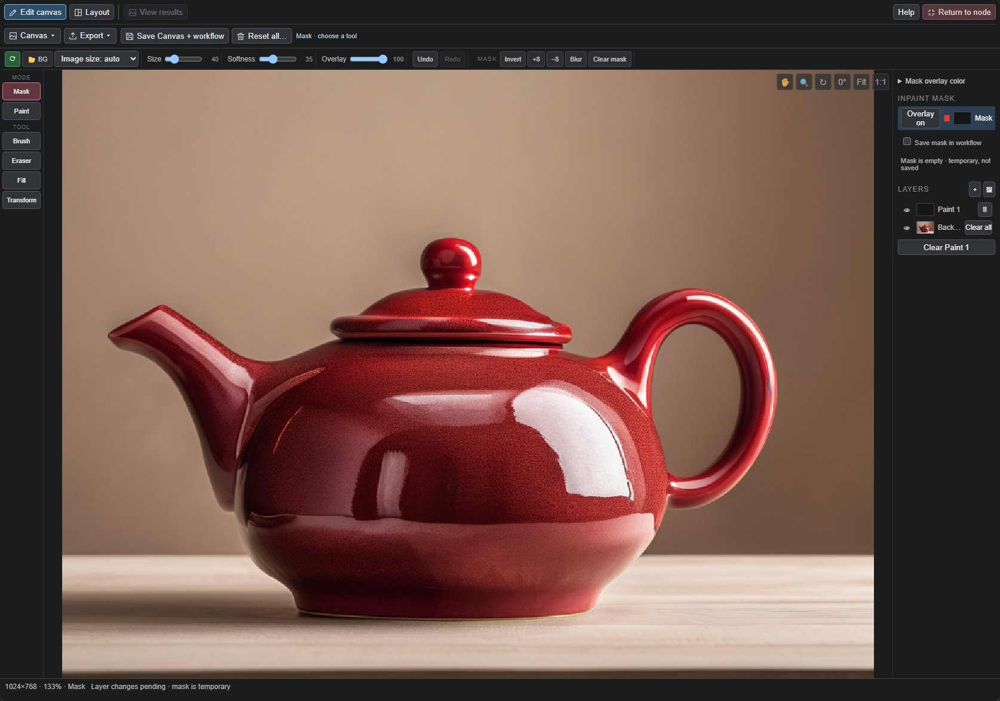

## What can you do with Powder?

| Your task | Useful nodes | What the setup gives you |
| --- | --- | --- |
| Compare wording for the same idea | Prompt List → Conditioner → Sampler | Keep several descriptions in the graph and generate a result for each enabled one. |
| Work through a collection of prompts | Prompt Wildcard | Read one or more lines per run, with a shared prefix/suffix and a choice to stop or loop at the end. |
| Explore a visual direction | Styler + Lora Loader + Conditioner | Change style text or LoRA choices while keeping the subject description separate. Use Grid Saver to compare the resulting images. |
| Prepare different output formats | Resolution + Sampler | Choose portrait, square or landscape dimensions and batch size; use a sampling profile appropriate to the loaded model. |
| Fix part of an image | Canvas + Image Conditioning + Canvas Review | Paint a mask, process the selected area, restore the edited crop and review alternatives before accepting a result. |
| Plan a composition or provide references | Canvas Layout + Conditioner; References + Image Conditioning | Describe where objects and text should appear, or give a supported editing model extra images to refer to. |
| Reuse a graph for different models | Switcher | Switch a matching model, text encoder and VAE together instead of rewiring each connection. |

These are combinations of tools, not complete wiring diagrams. The [ready-to-open workflows](#example-workflows) include loaders, encoders and decoding connections. Keep the seed and other settings fixed when comparing one change. Model support determines which generation, reference and editing features are available.

### Three ways to start

- **Improve an existing graph:** replace its size node with Resolution, add a Switcher, or send decoded images to Grid Saver. No full Powder pipeline is required.
- **Explore a subject:** write a few prompts, choose styles or LoRAs, generate variants and compare them in a grid. Change one factor at a time to understand its effect.
- **Refine an image:** open an Img2Img template, load the source in Canvas, paint a mask, describe the change and run it. Review the result before making it the new source.

## Installation

**Manager installation:** select version **2.0.6** explicitly when it is available. Registry review may delay availability or block installation. If this version is unavailable, use the Git installation below or wait for review. Avoid automatic downgrades to an older release.

Before reinstalling, back up the entire package folder outside `custom_nodes/`: personal styles and wildcard files are stored inside it.

After updating, restart ComfyUI and reload the browser. If you previously installed Registry 1.0.0, read the migration instructions below; do not install a second copy alongside it.

From your ComfyUI folder:

```sh
git clone https://github.com/E2GO/e2go-comfyui-nodes.git custom_nodes/e2go_nodes
```

Restart ComfyUI and reload the browser. Search for **Powder** in the node menu. The package uses ComfyUI's Python dependencies; model weights, text encoders, VAEs and LoRAs are not included.

For Registry installations, follow the temporary Manager instructions above. Registry 1.0.0 needs the special migration below. For a manual Git update, run `git pull` inside the installed package folder. Then restart ComfyUI and reload the browser. Back up your data and read the migration notes before updating from 1.x through either Manager or Git.

### Updating from 1.x to 2.0

**2.0 is a major update. Existing node identifiers are preserved, but some API inputs and bundled styles have changed. Matching results from old workflows are not guaranteed.**

Before updating, save your workflows and copy the entire installed package folder somewhere **outside ComfyUI's `custom_nodes/`**. This preserves `styles/`, `wildcards/`, and, for Git installs, `.git` and any stashes. Older bundled style files such as `styles/sdxl_styles_custom.json` are removed in 2.0; preserve your edits before updating. For Registry migration, wait until 2.0.6 is available following review before moving the old installation.

**Registry 1.0.0:** its published archive lacks `pyproject.toml`, so Manager may not recognize the existing installation. Update can fail with “Path not found”, while a new install can fail with “Install path already exists”. After making the backup, stop ComfyUI and move the old package folder (normally `custom_nodes/powder-nodes`) outside `custom_nodes/`. Restart ComfyUI and explicitly select Powder Nodes **2.0.6** in Manager's version selector. Restore your wildcard files and import your personal styles as described below, then restart ComfyUI and reload the browser. Do not copy the old package or its entire `styles/` folder over the new installation, and do not leave two copies of Powder Nodes in `custom_nodes/`.

**Git installs:** a manual `git pull` can stop on conflicting local edits. Manager's Git updater can instead stash tracked edits without restoring them, and can reset the checkout; an untracked file whose name is now supplied by 2.0 can also be overwritten. Back up before using either update path. If Manager already stashed edits, inspect `git stash list` and `git stash show -p "stash@{0}"` in the package folder to locate them; extract the needed entries into your user style file rather than blindly applying the whole stash to 2.0. Stashes do not guarantee recovery of overwritten untracked files.

The 2.0 bundled style filenames are `aesthetics.json`, `anime.json`, `cartoon.json`, `comics.json`, `craft.json`, `design.json`, `digital.json`, `drawing.json`, `emotions.json`, `film.json`, `games.json`, `image_edit.json`, `painting.json`, `photo.json`, `render3d.json`, and `utility.json`. Keep personal styles in `sdxl_styles_user.json` or a separate uniquely named JSON file instead of editing these files.

After updating, review style selections in older workflows. Some old style names are no longer included; a missing style is highlighted in the interface and skipped with a server-log warning. Even retained names have revised prompt text, and their old negative prompts are no longer bundled. To retain an old style exactly, copy its JSON entry from your backup into `styles/sdxl_styles_user.json` (a JSON list), preserving any entries already there. Use the original name to restore a missing old selection. If that name already exists in the new library, give the imported style a unique name and select it explicitly. User styles and separate custom style JSON files are loaded from `styles/`.

Browser workflows saved by the older four-field Wildcard and Registry 1.0.0 seven-field Wildcard restore their prompt, prefix, suffix and available file/range settings automatically. Save the graph again after checking it. Other behavior changes to review: a single negative prompt now applies to every prompt in a list (1.0.0 left subsequent negatives empty), and an enabled but missing LoRA stops execution instead of being silently skipped. Install the missing LoRA, select another one, or disable that entry.

For applications using saved **API-format** prompts, update these inputs or export a fresh API prompt after reviewing the graph in ComfyUI:

| Node | Changes required for old API prompts |
| --- | --- |
| `PowderPromptWildcard` | Rename `positive_text` to `positive_prompt_list` and `negative_text` to `negative_prompt_list`; add `loop: false`. If absent in an older Git prompt, also add `wildcard_file: "(none)"`, `start_index: 0`, and `count: 0`. Preserve existing file/range values. |
| `PowderStyler` | Add `strength_mode: "cond mix — node"`, `style_mix: 1.0`, `style_sweep: false`, `sweep_from: "None"`, and `sweep_to: "None"`. |

Keep the remaining inputs. These values disable the new sweep/loop options; they do not restore removed styles or guarantee identical images. Browser workflow JSON and API prompt JSON are different formats: reopening a graph does not update a previously exported API request.

### Supported setup and model files

The bundled templates target **ComfyUI 0.44.0 or newer and frontend 1.57.6 or newer**. This release was checked on 0.44.0 / 1.57.6 with Python 3.12.12 on Windows. The package requires Python 3.10+; a full Python 3.10 or Linux/macOS run has not been performed. Older ComfyUI versions may lack TextGenerate or the model-specific loader types used by these templates.

All template nodes belong to Powder or ComfyUI core/extras; no other custom-node pack is required. Open them from ComfyUI's Templates browser, or drag a JSON from [example_workflows](example_workflows) onto the graph.

| Model family | Image text encoder / loader type | VAE / latent |
| --- | --- | --- |
| SDXL | CLIP-L + CLIP-G from the checkpoint | SDXL VAE, 4 channels /8 |
| Z-Image Base / Turbo | Qwen3 4B, `lumina2` | Flux AE, 16 channels /8 |
| FLUX.2 Klein | Qwen3 8B, `flux2` | Flux2 VAE, 128 channels /16 |
| FLUX.3 Klein | Qwen3-VL 4B, `flux3` | Flux2 VAE, 128 channels /16 |
| BOOGU | Qwen3-VL 8B, `boogu` | Flux AE, 16 channels /8 |
| MOSS SFT | Qwen3.5 9B, `moss_image` | Flux2 VAE, 128 channels /16 |
| Krea 2 | Qwen3-VL 4B, `krea2` | Wan2.1 VAE; Auto creates a single-frame 3D latent |
| Qwen Image 2.1 | Qwen3-VL 8B, `qwen_image` | Qwen 2.1 VAE, 64 channels /16 |
| Ideogram 4 | Qwen3-VL 8B, `ideogram4` | Flux2 VAE; also load the unconditional model |

Select the correct Base, Turbo, Distilled or Edit weights for the recipe. Model files are separate downloads, and filenames vary between distributions. The loader fields and notes in each template identify its intended files; a sampling profile does not select them for you.

**Optional prompt enhancement:** FLUX.3 FULL templates use `qwen3.5_9b_flux3_prompt_upsampler_int8_convrot.safetensors`. Other non-Krea FULL enhancers use a separate `qwen3vl_4b_int8_convrot.safetensors` language model. Original mode bypasses that branch and does not require the enhancer model. Krea templates use their configured Krea text encoder. `E2GO_Krea2.json` includes optional prompt enhancement, per-run additional instructions, and automatic latent format selection. BOOGU Turbo prompt enhancement is included in `E2GO_Boogu_Turbo_Generate_full.json`.

**Layout AI assistant and scene synchronization** currently require the exact file `qwen3vl_4b_int8_convrot.safetensors` in ComfyUI's text-encoder model paths. Manual region editing and manually written scene text do not require this additional model.

## Start here

1. Open a JSON from [workflows](example_workflows) in ComfyUI. Start with [SDXL Generate](example_workflows/E2GO_SDXL_Generate.json) for a checkpoint-based workflow, or choose the template for your model family.
2. Select your installed model files in the loaders. Choose a matching latent format in Resolution and a matching profile in Sampler.
3. Enter a prompt, choose the size and queue the workflow. Templates ending in `_full` expose more controls; simpler templates provide a shorter starting point.
4. For editing, open an Img2Img or Edit template, load an image into Canvas, and follow its notes. A model must support the selected editing mode.

FULL editing templates also connect Resolution to Image Conditioning's `t2i_latent` input. In Generate mode, set the output size in Resolution; Repaint, Edit and Repair use the source image or crop instead. When using Layout, match its dimensions to the generated image with **Match generation size**, or enter the source/crop dimensions for editing.

The [English Node map](example_workflows/powder_node_guide.json) is a readable workflow covering all 16 nodes. Each card explains what the node does, why to use it, its inputs and outputs, and a connection example. A separate section explains independent nodes and features that need companions. The guide's processing nodes are disabled: it is a reference, not a generation workflow.

## Using Powder in ordinary workflows

**Independent nodes:** Prompt List, Prompt Wildcard, Lora Loader, Resolution, Conditioner, Sampler, Inpaint Sampler, Switcher and Grid Saver accept or produce standard ComfyUI types. They still need the usual compatible models and inputs.

For example, replace only Empty Latent Image with **Powder Resolution**:

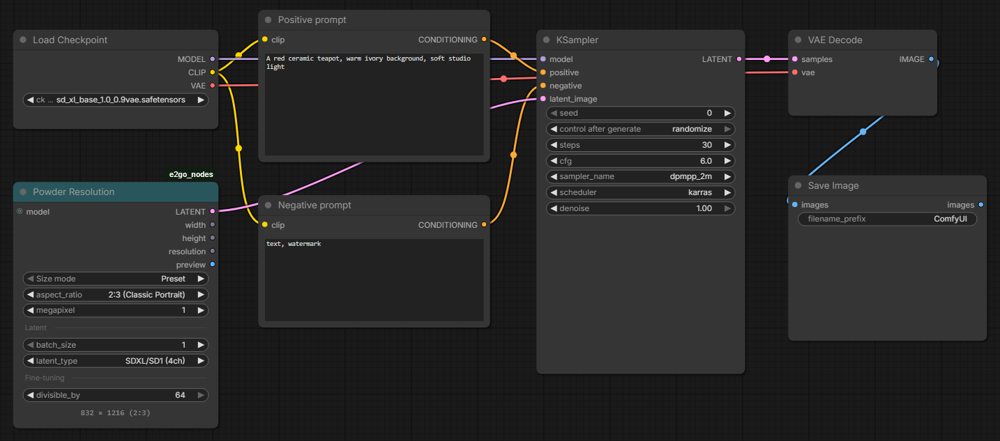

*Powder Resolution is the only Powder node here. The remaining nodes are standard ComfyUI loaders, encoders, sampling and image output.*

Connect the checkpoint's MODEL to KSampler and VAE to VAE Decode. For SDXL, choose the 4-channel latent format. A prompt list creates separate downstream executions; it is different from a latent image batch.

**Some features need companions:**

| Feature | Required connection |
| --- | --- |
| Full Styler settings, including conditioning mixing and negative styles | Styler.style → Conditioner.style. `style_text` alone is ordinary positive text for a standard encoder. |
| Automatic LoRA trigger assembly | Lora Loader.lora_info → Conditioner.lora_info. With standard CLIP Text Encode, add the trigger words yourself. |
| Canvas Layout | Canvas.layout → Conditioner.layout; use Powder Sampler for model and size validation. Layout describes composition; it is not a pixel mask. |
| Reference bundle | References → Conditioner.references and Image Conditioning.references. Standard encoders and KSampler do not accept POWDER_REFS. |
| Local crop restoration and in-canvas result review | Image Conditioning.stitch + decoded images → Canvas Review. Canvas image/mask outputs can otherwise feed standard nodes. |
| Mask-aware custom sampling | Inpaint Sampler.SAMPLER → SamplerCustomAdvanced.sampler, with standard noise, guider, sigmas and latent inputs. |

Cache Stats and Clear Conditioning Cache need no connected Powder node, but operate only on this package's caches. They do not manage all ComfyUI memory.

## The nodes in practice

Node names below match the ComfyUI menu, with the shared **Powder** prefix omitted for readability. *Conditioning* means the encoded instructions passed to the image model. A *latent* is the intermediate representation that VAE Decode converts into a viewable image.

### Prompts, styles and LoRAs

#### Prompt List — compare descriptions

Keep multiple positive/negative prompt pairs in one node and enable only the variants you want to try. Each enabled slot produces a separate prompt item, so you can compare wording without repeatedly replacing the same text field.

**Example:** try “a red ceramic teapot” and “a blue ceramic teapot” with the same model and seed. Connect the two output lists to standard positive/negative CLIP Text Encode nodes, or to Conditioner. No other Powder node is required. A prompt list runs downstream processing per item; it is different from a batch of latents.

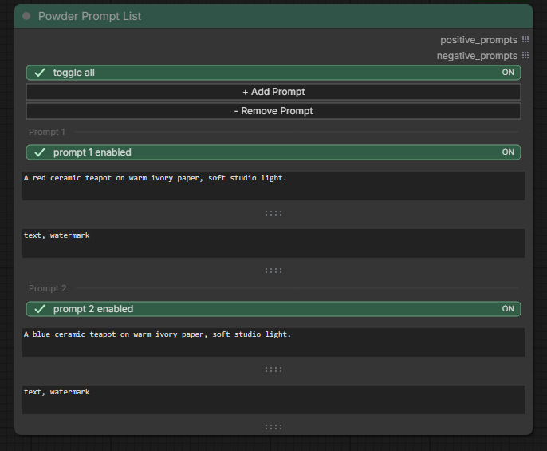

*Two enabled descriptions: change the teapot color while keeping the lighting and negative prompt the same.*

#### Prompt Wildcard — work through a list across runs

Read prompts from multiline text or a local file. Choose how many lines to use per run, add shared wording with prefix/suffix, and stop or loop when the list ends. Blank lines and `#` comments are skipped.

**Example:** enter forest, city and coast on separate lines. With `count=1`, successive queue actions use those descriptions in order. Outputs work with standard text encoders. This node selects text; it does not enqueue jobs itself or fix the sampler seed.

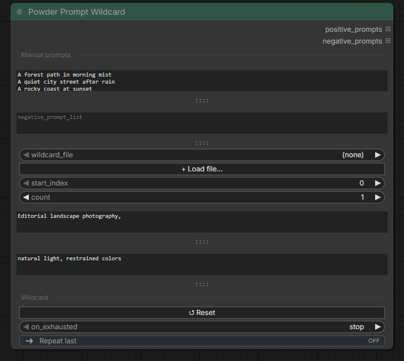

*Three prompt lines with a shared prefix and suffix; count = 1 selects one line per run.*

#### Lora Loader — combine LoRAs or compare them

Manage several LoRAs in one place, with individual enable switches, weights and trigger settings. **Stack** applies the enabled LoRAs together. **Single** tries them separately, with controls for the order of LoRA/prompt combinations. Bypass LoRA CLIP skips the LoRA's text-encoder weights.

**Example:** compare two compatible illustration LoRAs using the same subject. MODEL and CLIP outputs connect to standard sampling and encoding nodes. Automatic trigger assembly uses `lora_info` with Conditioner; with a standard text encoder, enter the trigger words yourself. LoRAs must match the model family. Trigger edits stay in the workflow; running a graph never writes to the `.txt` files beside your LoRA weights.

#### Styler — separate the subject from its visual treatment

Choose reusable style descriptions without rewriting your subject prompt. Enable positive and negative style text separately, combine styles, adjust their contribution or cycle through a selection with Style Sweep. You can also save your own styles. Bundled styles currently use positive suffix text only: their negative switch has no effect, and Wrap/After place that suffix after the subject. Prefix and negative controls become useful with styles that actually contain those fields.

**Example:** keep “a house beside a lake” as the subject and compare a photograph with a watercolor treatment. Send `style` to Conditioner for the full settings. The ordinary `style_text` output can be combined with your prompt for a standard encoder, but it does not reproduce negative styles or conditioning-mix weights.

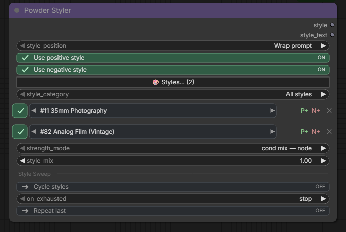

#### Conditioner — assemble and encode the final prompt

Turn positive and negative text into model instructions. Optionally add Styler settings, LoRA triggers, supported references and Canvas Layout. The final text outputs let you inspect what was assembled; caching can reuse unchanged encodings across runs.

**Example:** keep the subject in Prompt List, the visual treatment in Styler and trigger metadata in Lora Loader, then join them in Conditioner. For basic use, supply only a compatible CLIP encoder and text and connect the conditioning outputs to a standard KSampler. Caching saves repeated text encoding, not the sampling of a new image. Auto conservatively bypasses Flux/T5 and quantized encoder classes. Aggressive enables caching for these encoders when appropriate; CLIPs with hooks or schedules always encode fresh to avoid stale weights or conditioning metadata.

### Size and generation

#### Resolution — choose dimensions without calculating them manually

Pick a preset, an aspect ratio with a target image area, or explicit pixel dimensions. Set batch size and create an empty latent for the model. Optional automatic format selection uses a connected MODEL; the preview shows the chosen proportions.

**Example:** switch a composition from square to portrait while keeping approximately the same megapixel count. Connect `LATENT` directly to standard KSampler. No other Powder node is required. The latent format must match the model, and dimensions may be rounded to its supported grid.

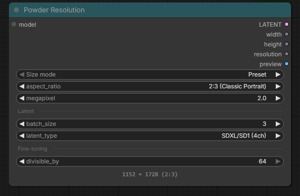

*A portrait preset, a batch of three and the 4-channel latent format used by SDXL.*

#### Sampler — generate with model-aware controls

Sample from an empty latent or redraw a prepared source. Alongside seed, steps, CFG, algorithm and scheduler, the node offers model profiles, optional step scaling by denoise, mask refinement and batch similarity controls. Similarity blends the noise used by images in one batch; it is not a guarantee of identical composition or identity.

**Example:** load SDXL, select its profile and click **Apply profile to sampler** to populate the visible sampling settings. Connect standard model, conditioning and latent inputs, then send the output to VAE Decode. No other Powder node is required. Applying a profile does not load or change the model.

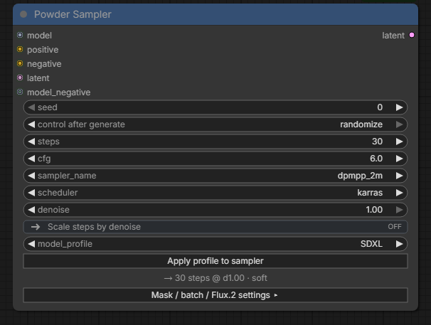

#### Inpaint Sampler — bring mask refinement to custom sampling

Select a sampling algorithm and inpaint boost level for a graph that already uses a custom guider, noise source and sigma schedule. This node produces a **SAMPLER component**, rather than running the generation itself.

**Example:** connect its `SAMPLER` output to `SamplerCustomAdvanced.sampler` and keep your existing standard inputs for noise, guider, sigmas and latent. Other Powder nodes are optional. The latent needs a noise mask for mask refinement; this output does not plug into ordinary KSampler. Compare boost settings at the same seed—stronger is not always better.

### Canvas, references and editing

#### Canvas — prepare the source and the area to change

Load an image or start a blank canvas, work with layers, paint a mask and transform content in an expanded editor. Canvas provides ordinary image/mask outputs. Its Layout tab separately describes the placement of objects, characters and text for supported models.

**Example:** load a product photo and mask the area you want to repaint. Image and mask outputs work with standard ComfyUI nodes. Add Image Conditioning and Canvas Review for the integrated edit-and-review process. Layout uses Conditioner; opening the tab alone does not enable Layout in generation.

#### References — keep reference images consistent through an edit

Bundle the source and up to four additional reference images so text and image conditioning use the same set. The node organizes inputs; the selected model supplies the ability to understand and use them.

**Example:** provide a source image and a separate clothing reference, then describe the requested change. Connect the same bundle to `Conditioner.references` and `Image Conditioning.references`, and connect the actual source to `Image Conditioning.pixels`. This feature requires the Powder consumers and a compatible reference-editing model. Standard encoders and KSampler cannot consume the bundle directly.

#### Image Conditioning — prepare the chosen kind of edit

Prepare the model, conditioning and latent for **Generate**, **Repaint**, **Repair** or **Edit**. Repaint redraws the source; Repair works on a crop around the mask; Edit uses model-specific editing/reference support. The node also supplies denoise and the context needed to restore an edited crop.

**Example:** repair a small area without processing the whole image at full size. Pass the prepared outputs to the sampler, decode the result and send both the image and `stitch` context to Canvas Review. Basic generation and full-image img2img can use standard surrounding nodes; restoring the crop requires Canvas Review. An empty mask selects the whole image. **Edit (native)** encodes the source without injecting Powder reference latents; use it when the model-specific text encoder already supplies native editing conditioning.

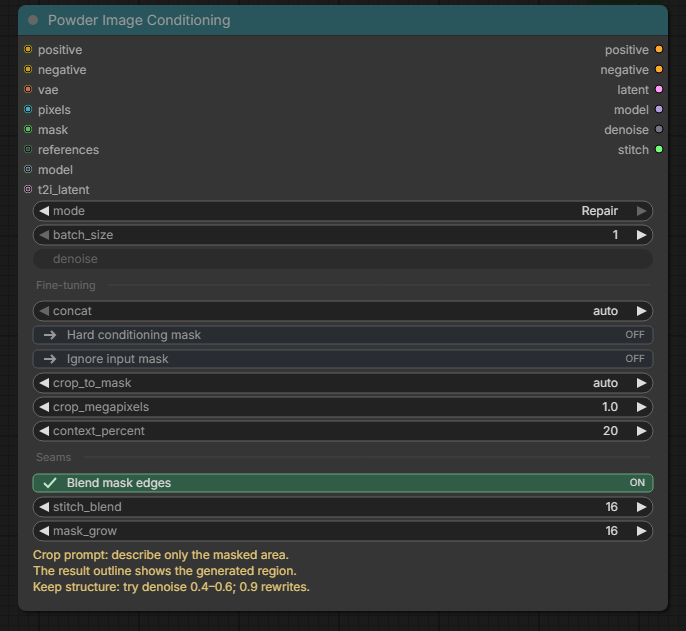

*Repair mode exposes crop context, mask growth and edge blending controls for a local edit.*

#### Canvas Review — inspect results and restore edited crops

Receive decoded results and, when stitch context is supplied, place the processed region back into the source using the saved mask and blending settings. A connected Canvas can show the variants for review. Accepting a result makes it the next source, so you can continue editing in steps.

**Example:** generate several local repairs, compare them in Canvas, then accept the best one. Connect `Image Conditioning.stitch` and the decoded images to Review, and save its final image output. Plain image review works without other Powder nodes; crop restoration needs Image Conditioning and in-editor review needs Canvas. Saving directly from VAE Decode bypasses stitching.

### Switching, comparison and maintenance

#### Switcher — change a related set of inputs together

Organize alternatives into groups with corresponding channels. One selection chooses the active group, which is useful for keeping a model, CLIP encoder and VAE together. It selects values rather than blending them.

**Example:** connect two checkpoint loaders as groups A and B and send the selected outputs into the same generation chain. No other Powder node is required. Corresponding channel types must be compatible. A separate output on an unselected branch can still cause that branch to run independently.

#### Grid Saver — make comparisons easier to read

Arrange generated images into rows and columns and save a combined grid. Optional prompt, seed, style and LoRA metadata helps label the variants; parameter data can also be saved as JSON.

**Example:** collect the images from a LoRA comparison into one sheet instead of opening them one by one. Connect decoded images directly for a simple grid, or add Powder metadata for richer labels. No other Powder node is required. This node writes files; in FULL templates it initially starts bypassed, so enable it when you want a grid.

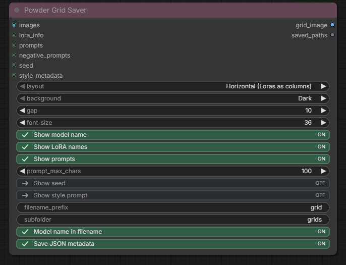

*Grid layout, labels and file settings are collected in one node.*

#### Cache Stats — see what the package is reusing

Inspect the package's cached conditioning, raw LoRA data and styles. The report helps you check whether repeated runs reuse previously prepared data without clearing anything.

**Example:** run the same text through Conditioner twice, then send `Cache Stats.stats` to Preview Any to inspect the report. No connected Powder node is needed, but the report covers this package's caches, not all of ComfyUI or total GPU memory.

#### Clear Conditioning Cache — request fresh text encoding

Clear Powder Conditioner's cached text encodings when you want them computed again. Change the trigger or use the button, then execute the cleanup. This is an occasional maintenance tool; using it before every generation removes the benefit of caching.

**Example:** execute the cleanup separately, then rerun the generation graph. No connections are required. It does not delete images, clear standard encoders' caches or unload all models from GPU memory.

For port-by-port examples and compatibility notes inside ComfyUI, open the [English Guide — Node map](example_workflows/powder_node_guide.json).

## Canvas and Layout

Use **Edit canvas** for image layers and masks. Repaint redraws the source; Repair processes a crop around the mask; Edit uses the selected model's editing capability. Describe the region you want to change. An empty mask means the whole image. Lower denoise preserves more of the source; higher denoise permits larger changes.

**View results** lets you compare generated variants. Accept a result to make it the next source image. With Image Conditioning and Canvas Review, the stitch context restores the crop and preserves the area outside the edit.

**Layout** describes where objects, characters and text should appear. Turn on **Use layout**, choose the matching model, and sync the scene after changing regions. Region boxes are composition instructions, not hard pixel constraints or masks. Reset all clears content while keeping the current tab.

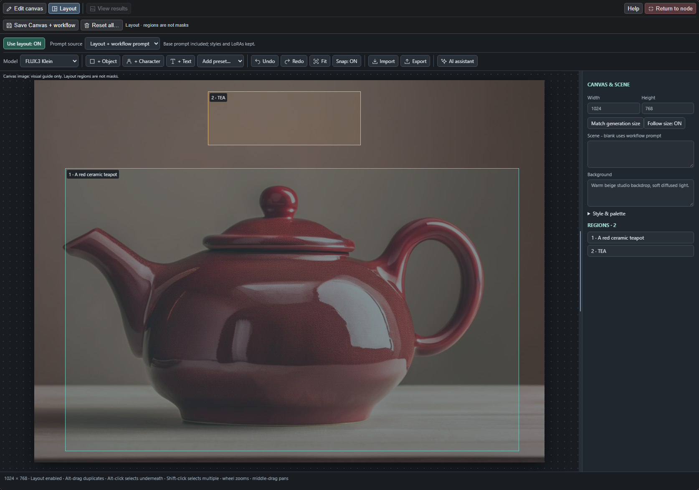

Enable **Save mask in workflow** if the mask should return when you reopen the graph. Wait for saving to finish before saving the workflow. Canvas assets and queued snapshots live in `ComfyUI/input/e2go_canvas`; keep them while saved workflows, queue items or history still need them. A workflow JSON alone does not include every external image or model file.

## Example workflows

The [workflow folder](example_workflows) contains 43 templates for SDXL, FLUX.2 Klein, FLUX.3 Klein, BOOGU, Z-Image, MOSS SFT, Krea 2, Qwen 2.1 and Ideogram 4. The notes inside each graph explain its intended mode and model setup. Model names in templates are examples: select the corresponding files installed on your machine. Some families need recent model-specific ComfyUI core nodes; use the supported versions listed above.

**FLUX.2 Klein:** Install both checkpoints before using these switchable templates: ComfyUI validates both loaders even though only one branch runs. Each template offers **Standard / KV**: `flux-2-klein-9b-fp8.safetensors` or `flux-2-klein-9b-kv-fp8.safetensors`. Only the selected model runs; the KV branch includes FluxKVCache. Both use Qwen3 8B (`flux2`), Flux2 VAE and the Flux 2 Klein Distilled sampler profile: 4 steps, CFG 1, Euler/simple. For reference-image editing, use FULL Img2Img and select **Edit (native)**. Repaint is ordinary img2img; KV caching benefits reference-image editing. These templates do not use the separate Base checkpoint.

| Start with | Workflow |
| --- | --- |
| SDXL text to image | [Generate](example_workflows/E2GO_SDXL_Generate.json) / [Full](example_workflows/E2GO_SDXL_Generate_full.json) |
| SDXL image to image | [Img2Img](example_workflows/E2GO_SDXL_Img2Img_full.json) |
| FLUX.3 Klein | [Generate](example_workflows/E2GO_Flux3_Klein_Base_Generate.json) / [Edit](example_workflows/E2GO_Flux3_Klein_Base_Edit.json) |
| BOOGU | [Generate](example_workflows/E2GO_Boogu_Base_Generate.json) / [Edit](example_workflows/E2GO_Boogu_Edit.json) |
| Krea 2 | [Generate](example_workflows/E2GO_Krea2_Generate_simple.json) / [Edit](example_workflows/E2GO_Krea2_Edit_simple.json) |
| Qwen 2.1 | [Generate](example_workflows/E2GO_Qwen21_Generate_simple.json) / [Edit](example_workflows/E2GO_Qwen21_Edit_simple.json) |
| Learn the nodes | [Guide — Node map](example_workflows/powder_node_guide.json) |

**Ideogram 4:** [LITE](example_workflows/E2GO_Ideogram4_Generate.json) contains a complete editable JSON caption. [FULL](example_workflows/E2GO_Ideogram4_Generate_full.json) defaults to **Enhanced**, using a separate local Qwen3-VL 4B model to describe the scene, style, background and objects. **Original** skips the enhancer; use a complete manual caption on that path. Plain text remains accepted, but wrapping it in empty JSON fields does not provide the same structure. The enhancer describes placement in words and is instructed to preserve supplied coordinates instead of inventing them; use Canvas Layout for explicit regions. Review the generated caption: an enhancer can change details, and valid JSON alone does not guarantee a usable image.

In Powder Sampler, **Ideogram sampling** offers **Standard** (default) and **First sigma +0.005 (experimental)**. The alternative changes only the first sampled sigma, keeping the step count and model weights. It can help with gray placeholders but may alter composition or introduce artifacts. It is independent of Original / Enhanced, and other model families ignore it. Compare with the same fixed seed. Restart ComfyUI after updating to see the control; saved workflows without it retain Standard.

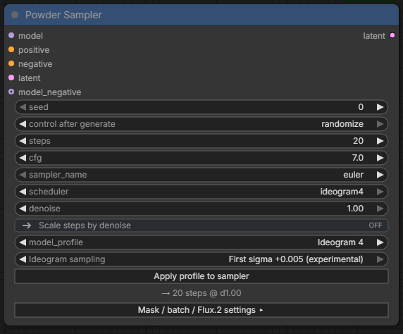

## Local data and troubleshooting

Wildcard and Style Sweep progress is session-local: reloading the browser or restarting the server starts a fresh cursor. Reset sets `start_index` to zero. Repeat last holds the selected text/style for subsequent runs; it does not queue a job or restore a seed.

With `stitch_blend > 0`, fully painted pixels keep the full generated change, and a surrounding feather band can also change within the decoded crop. Pixels beyond that band remain unchanged. Use `stitch_blend=0` for strict preservation outside the effective mask; `mask_grow` deliberately enlarges that mask. Cropped batches retain each source and use a shared crop enclosing all active masks.


- Personal styles are stored in `styles/sdxl_styles_user.json`; local wildcard files are stored in `wildcards/`. Both are ignored by Git so normal updates preserve them.
- If the UI looks outdated after an update, restart ComfyUI and reload the browser.
- If sampling reports a latent/model mismatch, check the selected model, Resolution latent format and Sampler profile together. Applying a profile changes sampler settings, not the loaded model.
- A stopped style or wildcard sweep may have reached its end. Choose Loop or reset the selection.
- Report reproducible problems through [GitHub Issues](https://github.com/E2GO/e2go-comfyui-nodes/issues), including your ComfyUI version, workflow and error text.

## Contributors

- **E2GO** — project author and maintainer.
- **Claude (Anthropic)** — AI assistance with the project's initial development and early maintenance.
- **Codex (OpenAI)** — AI assistance with development, testing, release preparation and documentation.

## License

[GNU Affero General Public License v3.0](LICENSE).

**English** | [Русский](README.ru.md)
