# Powder Nodes для ComfyUI

[English](README.md) | **Русский**

16 нод ComfyUI для поиска визуальных идей, сравнения вариантов и редактирования результатов. Разделяйте описание сюжета, стили и LoRA, чтобы менять их независимо; выбирайте размер и настройки генерации; затем исправляйте изображение в Canvas или собирайте варианты в сетку для сравнения.

**Можно начать с одной полезной ноды или взять готовый воркфлоу.** Многие ноды Powder работают со стандартными нодами ComfyUI. Инструменты редактирования также объединяются в связку: подготовить изменение, сгенерировать варианты, сравнить их и принять один как новый исходник.

[Выбрать задачу](#что-можно-делать-с-powder) · [Установка](#установка) · [Пример с одной нодой](#использование-в-обычных-воркфлоу) · [Все 16 нод](#ноды-на-практике) · [Готовые воркфлоу](#примеры-воркфлоу)

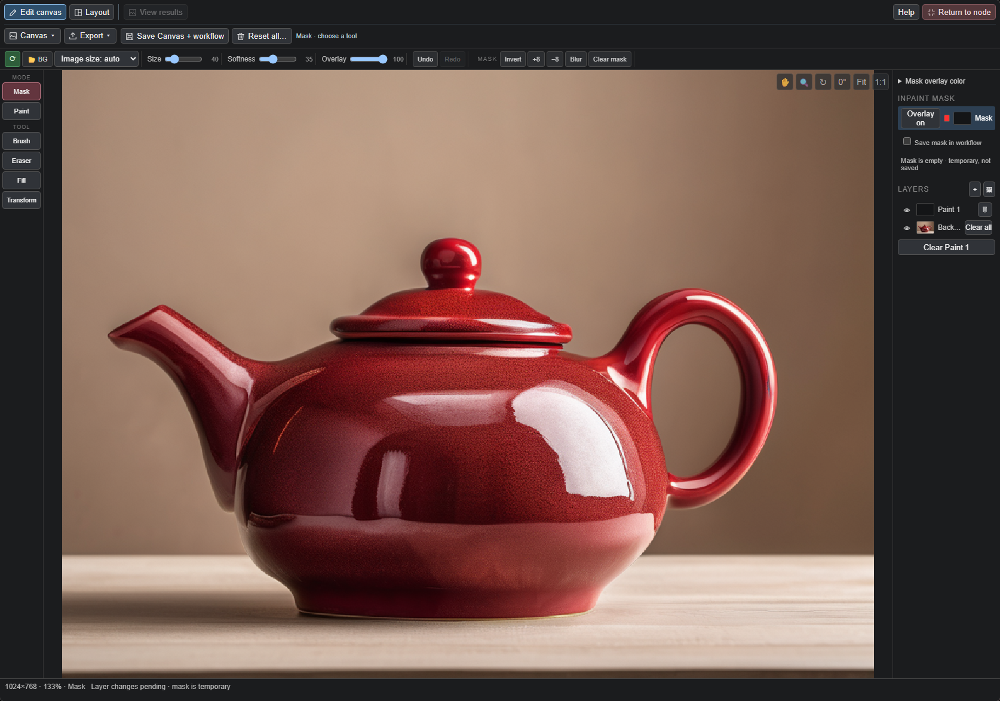

## Что можно делать с Powder?

| Задача | Полезные ноды | Что даёт такая связка |
| --- | --- | --- |
| Сравнить формулировки одной идеи | Prompt List → Conditioner → Sampler | Несколько описаний остаются в графе; каждое включённое описание даёт свой вариант генерации. |
| Пройтись по подборке промптов | Prompt Wildcard | Одна или несколько строк за запуск, общие префикс и суффикс, остановка или повтор списка в конце. |
| Найти визуальный стиль | Styler + Lora Loader + Conditioner | Можно менять стилевой текст и LoRA, сохраняя описание сюжета отдельно. Grid Saver помогает сравнить полученные изображения. |
| Подготовить разные форматы изображения | Resolution + Sampler | Портретные, квадратные и широкие размеры, число вариантов в батче и подходящий профиль сэмплинга. |
| Исправить часть изображения | Canvas + Image Conditioning + Canvas Review | Нарисовать маску, обработать область, вернуть фрагмент на место и сравнить варианты перед принятием результата. |
| Задать композицию или референсы | Canvas Layout + Conditioner; References + Image Conditioning | Описать расположение объектов и текста или передать дополнительные изображения модели, которая поддерживает такое редактирование. |
| Использовать один граф с разными моделями | Switcher | Переключать модель, текстовый энкодер и VAE вместе, не переподключая каждый провод. |

В таблице показаны сочетания инструментов, а не полные схемы подключения. В [готовых воркфлоу](#примеры-воркфлоу) уже есть загрузчики, энкодеры и декодирование. Для сравнения одного изменения фиксируйте seed и остальные настройки. Доступность генерации, референсов и режимов редактирования зависит от модели.

### Три способа начать

- **Улучшить свой граф:** заменить ноду размера на Resolution, добавить Switcher или отправить декодированные изображения в Grid Saver. Полная цепочка Powder не обязательна.
- **Исследовать сюжет:** написать несколько промптов, выбрать стили или LoRA, получить варианты и сравнить их в сетке. Меняйте один фактор за раз, чтобы видеть его влияние.
- **Доработать изображение:** открыть шаблон Img2Img, загрузить исходник в Canvas, нарисовать маску, описать изменение и запустить генерацию. Сначала оцените результат, затем сделайте его новым исходником.

## Установка

В папке ComfyUI выполните:

```sh
git clone https://github.com/E2GO/e2go-comfyui-nodes.git custom_nodes/e2go_nodes
```

Перезапустите ComfyUI и обновите страницу. В меню добавления нод ищите **Powder**. Пакет использует Python-зависимости ComfyUI. Модели, текстовые энкодеры, VAE и LoRA нужно установить отдельно.

Если установка распознаётся как пакет Registry, обновите **Powder Nodes** через ComfyUI Manager. Для Registry 1.0.0 нужен отдельный порядок перехода ниже. Для ручного Git-обновления выполните `git pull` в папке установленного пакета. Затем перезапустите ComfyUI и обновите страницу. До обновления с 1.x через Manager или Git сохраните данные и прочитайте инструкцию перехода.

### Переход с 1.x на 2.0

**2.0 — крупное обновление. Идентификаторы прежних нод сохранены, но часть API-входов и встроенных стилей изменилась. Совпадение результатов старых воркфлоу не гарантируется.**

Перед обновлением сохраните воркфлоу и скопируйте всю папку установленного пакета **за пределы `custom_nodes/` ComfyUI**. Так сохранятся `styles/`, `wildcards/`, а для Git-установки — также `.git` и отложенные изменения в stash. Старые комплектные файлы стилей, например `styles/sdxl_styles_custom.json`, удаляются в 2.0; сохраните свои правки заранее.

**Registry 1.0.0:** опубликованный архив не содержит `pyproject.toml`, поэтому Manager может не распознать установку. Обновление может завершиться ошибкой «Path not found», а новая установка — «Install path already exists». Сделав резервную копию, остановите ComfyUI и перенесите папку старого пакета (обычно `custom_nodes/powder-nodes`) за пределы `custom_nodes/`. Запустите ComfyUI и установите Powder Nodes 2.0.0 через Manager, когда эта версия станет доступна. Верните свои wildcard-файлы и импортируйте личные стили по инструкции ниже, затем перезапустите ComfyUI и обновите страницу. Не копируйте старый пакет или всю старую папку `styles/` поверх новой установки и не оставляйте две копии Powder Nodes в `custom_nodes/`.

**Git-установки:** ручной `git pull` может остановиться при конфликте локальных правок. Git-обновление через Manager может вместо этого убрать отслеживаемые правки в stash без возврата и сбросить рабочее дерево; неотслеживаемый файл с именем, которое теперь поставляет 2.0, тоже может быть перезаписан. Сделайте копию перед любым способом обновления. Если Manager уже убрал правки в stash, найдите их командами `git stash list` и `git stash show -p "stash@{0}"` в папке пакета; перенесите нужные записи в пользовательский файл стилей, не применяя весь stash к 2.0 вслепую. Stash не гарантирует восстановление перезаписанных неотслеживаемых файлов.

Имена комплектных файлов стилей 2.0: `aesthetics.json`, `anime.json`, `cartoon.json`, `comics.json`, `craft.json`, `design.json`, `digital.json`, `drawing.json`, `emotions.json`, `film.json`, `games.json`, `image_edit.json`, `painting.json`, `photo.json`, `render3d.json`, `utility.json`. Личные стили храните в `sdxl_styles_user.json` или отдельном JSON-файле с уникальным именем, а не в этих файлах.

После обновления проверьте выбор стилей в старых графах. Некоторые прежние названия больше не входят в библиотеку; отсутствующий стиль подсвечивается в интерфейсе и пропускается с предупреждением в логе сервера. Даже у сохранившихся названий текст промпта изменён, а прежние негативные промпты больше не входят в библиотеку. Чтобы точно сохранить старый стиль, перенесите его JSON-запись из резервной копии в `styles/sdxl_styles_user.json` (список JSON), сохранив уже имеющиеся записи. Исходное имя восстановит отсутствующий прежний выбор. Если такое имя уже есть в новой библиотеке, дайте импортированному стилю уникальное имя и выберите его явно. Пользовательские стили и отдельные JSON-файлы стилей загружаются из `styles/`.

Браузерные графы со старым четырёхпольным Wildcard и семипольным Wildcard из Registry 1.0.0 автоматически восстанавливают промпт, префикс, суффикс и имеющиеся настройки файла и диапазона. После проверки сохраните граф заново. Учтите и другие изменения поведения: один негативный промпт теперь применяется ко всем промптам списка (в 1.0.0 последующие негативы оставались пустыми), а включённый, но отсутствующий LoRA останавливает выполнение вместо молчаливого пропуска. Установите нужный LoRA, выберите другой или отключите эту запись.

Для приложений с сохранёнными промптами **в API-формате** обновите следующие входы либо заново экспортируйте API-промпт после проверки графа в ComfyUI:

| Нода | Изменения в старом API-промпте |
| --- | --- |
| `PowderPromptWildcard` | Переименовать `positive_text` в `positive_prompt_list`, `negative_text` в `negative_prompt_list`; добавить `loop: false`. Если в старом Git-промпте отсутствуют настройки файла и диапазона, добавить `wildcard_file: "(none)"`, `start_index: 0`, `count: 0`. Уже имеющиеся значения сохранить. |
| `PowderStyler` | Добавить `strength_mode: "cond mix — node"`, `style_mix: 1.0`, `style_sweep: false`, `sweep_from: "None"`, `sweep_to: "None"`. |

Остальные входы сохраняются. Эти значения отключают новые режимы перебора и повтора, но не возвращают отсутствующие стили и не гарантируют одинаковые изображения. JSON браузерного воркфлоу и JSON API-промпта — разные форматы: открытие графа не меняет ранее экспортированный API-запрос.

### Поддерживаемое окружение и файлы моделей

Готовые шаблоны рассчитаны на **ComfyUI 0.44.0 и новее, frontend 1.57.6 и новее**. Релиз проверен на 0.44.0 / 1.57.6 с Python 3.12.12 в Windows. Пакету нужен Python 3.10+; полный запуск на Python 3.10 и Linux/macOS не выполнялся. В старых версиях ComfyUI могут отсутствовать TextGenerate и типы загрузчиков для новых моделей.

Все ноды шаблонов относятся к Powder либо ядру/ComfyUI extras; другие наборы кастомных нод не нужны. Откройте шаблон через Templates в ComfyUI или перетащите JSON из [example_workflows](example_workflows) на граф.

| Семейство модели | Текстовый энкодер изображения / тип загрузчика | VAE / латент |
| --- | --- | --- |
| SDXL | CLIP-L + CLIP-G из checkpoint | SDXL VAE, 4 канала /8 |
| Z-Image Base / Turbo | Qwen3 4B, `lumina2` | Flux AE, 16 каналов /8 |
| FLUX.2 Klein | Qwen3 8B, `flux2` | Flux2 VAE, 128 каналов /16 |
| FLUX.3 Klein | Qwen3-VL 4B, `flux3` | Flux2 VAE, 128 каналов /16 |
| BOOGU | Qwen3-VL 8B, `boogu` | Flux AE, 16 каналов /8 |
| MOSS SFT | Файлы указаны в загрузчиках шаблона MOSS, `moss_image` | Совместимый MOSS VAE, 128 каналов /16 |
| Krea 2 | Qwen3-VL, `krea2`; файл указан в шаблоне | Соответствующий Krea VAE; Auto создаёт однокадровый 3D-латент |
| Qwen Image 2.1 | Qwen3-VL, `qwen_image`; файл указан в шаблоне | Qwen 2.1 VAE, 64 канала /16 |
| Ideogram 4 | Энкодеры указаны в шаблоне, `ideogram4` | Соответствующий VAE; также нужна unconditional-модель |

Выбирайте веса Base, Turbo, Distilled или Edit под конкретный рецепт. Модели скачиваются отдельно; имена файлов у разных сборок могут отличаться. Загрузчики и заметки шаблона показывают нужный комплект. Профиль сэмплера не выбирает файлы моделей автоматически.

**Необязательное улучшение промпта:** FULL-шаблоны FLUX.3 используют `qwen3.5_9b_flux3_prompt_upsampler_int8_convrot.safetensors`. Остальные FULL-enhancer вне семейства Krea используют отдельную языковую модель `qwen3vl_4b_int8_convrot.safetensors`. Режим Original обходит эту ветку и не требует её модели. Шаблоны Krea используют настроенный текстовый энкодер Krea. `E2GO_Krea2.json` и `E2GO_Krea2_Prompt_Enhancer_full.json` содержат одинаковую схему генерации с разными префиксами сохранения.

**AI assistant и синхронизация сцены Layout** сейчас требуют файл с точным именем `qwen3vl_4b_int8_convrot.safetensors` в путях текстовых энкодеров ComfyUI. Ручное редактирование регионов и самостоятельный ввод описания сцены не требуют этой дополнительной модели.

## С чего начать

1. Откройте JSON из папки [workflows](example_workflows) в ComfyUI. Для обычного checkpoint начните с [SDXL Generate](example_workflows/E2GO_SDXL_Generate.json), для другой модели выберите соответствующий шаблон.
2. Выберите установленные файлы в загрузчиках. Укажите подходящий формат латента в Resolution и профиль модели в Sampler.
3. Введите промпт, задайте размер и запустите очередь. Варианты `_full` содержат больше настроек; простые шаблоны удобнее для первого запуска.
4. Для редактирования откройте Img2Img или Edit, загрузите изображение в Canvas и следуйте заметкам внутри графа. Модель должна поддерживать выбранный режим.

[Guide — Node map](example_workflows/powder_node_guide.json) — справочный воркфлоу на английском со всеми 16 нодами. В карточках объясняется, что делает каждая нода, зачем она нужна, какие данные принимает и выдаёт, как её подключить. Отдельный раздел посвящён независимым нодам и функциям, которым нужна связка. Вычислительные ноды справочника отключены: это карта для чтения, а не граф генерации.

## Использование в обычных воркфлоу

**Самостоятельно работают:** Prompt List, Prompt Wildcard, Lora Loader, Resolution, Conditioner, Sampler, Inpaint Sampler, Switcher и Grid Saver. Им достаточно стандартных нод ComfyUI с совместимыми входами и моделями.

Например, замените только Empty Latent Image на **Powder Resolution**:

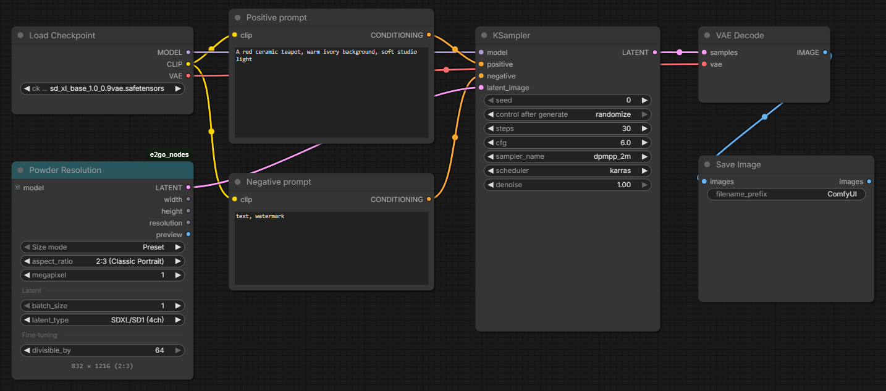

*Powder Resolution — единственная нода Powder в этом графе. Остальное — стандартные загрузчик, энкодеры, сэмплинг и вывод изображения ComfyUI.*

Подключите MODEL из checkpoint к KSampler, а VAE — к VAE Decode. Для SDXL выберите латент с 4 каналами. Список промптов запускает дальнейшие ноды отдельно для каждого пункта; это не то же самое, что батч латентов.

**Некоторые функции требуют связки:**

| Функция | Подключение |
| --- | --- |
| Полные настройки Styler, смешивание кондишнинга и негативные стили | Styler.style → Conditioner.style. Выход `style_text` можно использовать как обычный позитивный текст со стандартным энкодером. |
| Автоматическая сборка триггеров LoRA | Lora Loader.lora_info → Conditioner.lora_info. При стандартном CLIP Text Encode впишите триггеры самостоятельно. |
| Canvas Layout | Canvas.layout → Conditioner.layout; Powder Sampler проверяет модель и размер. Layout описывает композицию, а не пиксельную маску. |
| Пакет референсов | References → Conditioner.references и Image Conditioning.references. Стандартные энкодеры и KSampler не принимают POWDER_REFS. |
| Возврат локального фрагмента и просмотр результатов в Canvas | Image Conditioning.stitch и декодированные изображения → Canvas Review. Обычные image/mask из Canvas можно подключать к стандартным нодам. |
| Расширенный сэмплинг с маской | Inpaint Sampler.SAMPLER → SamplerCustomAdvanced.sampler; noise, guider, sigmas и latent можно получить стандартными нодами. |

Cache Stats и Clear Conditioning Cache не требуют подключённых нод Powder, но работают только с кешами этого пакета, а не со всей памятью ComfyUI.

## Ноды на практике

Названия ниже соответствуют меню ComfyUI; общий префикс **Powder** опущен для удобства чтения. *Кондишнинг* — закодированные инструкции, которые получает модель изображения. *Латент* — промежуточное представление, которое VAE Decode превращает в видимое изображение.

### Промпты, стили и LoRA

#### Prompt List — сравнение описаний

Хранит несколько пар позитивного и негативного промптов в одной ноде. Можно включить только нужные варианты. Каждый активный слот создаёт отдельный элемент списка: удобно сравнивать формулировки, не заменяя текст вручную перед каждым запуском.

**Пример:** сравните «красный керамический чайник» и «синий керамический чайник» с одной моделью и seed. Подключите два списка к стандартным позитивному и негативному CLIP Text Encode либо к Conditioner. Другие ноды Powder не обязательны. Список промптов запускает дальнейшую обработку для каждого пункта; это отличается от батча латентов.

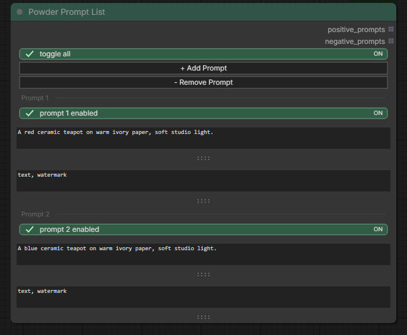

*Два включённых описания: меняется цвет чайника, освещение и негативный промпт остаются одинаковыми.*

#### Prompt Wildcard — последовательная работа со списком

Читает промпты из многострочного поля или локального файла. Можно выбрать число строк за запуск, добавить общие префикс и суффикс, остановиться в конце списка или начать его заново. Пустые строки и комментарии с `#` пропускаются.

**Пример:** запишите лес, город и побережье на отдельных строках. При `count=1` последовательные запуски очереди используют эти описания по порядку. Выходы работают со стандартными текстовыми энкодерами. Нода выбирает текст, но сама не ставит задания в очередь и не фиксирует seed сэмплера.

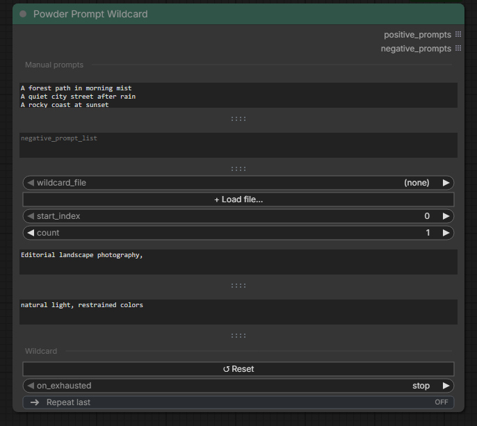

*Три строки с общими префиксом и суффиксом; count = 1 выбирает одну строку за запуск.*

#### Lora Loader — сочетание и сравнение LoRA

Позволяет управлять несколькими LoRA в одном месте: включать их отдельно, задавать веса и настройки триггеров. **Stack** применяет включённые LoRA вместе, **Single** пробует их по отдельности. Есть выбор порядка сочетаний LoRA и промптов. Bypass LoRA CLIP пропускает веса LoRA для текстового энкодера.

**Пример:** сравните две совместимые иллюстративные LoRA на одном сюжете. Выходы MODEL и CLIP подключаются к стандартным нодам сэмплинга и кодирования. Для автоматического добавления триггеров передайте `lora_info` в Conditioner; со стандартным энкодером впишите триггеры сами. LoRA должны подходить семейству модели. Изменения триггеров сохраняются в воркфлоу; запуск графа не записывает данные в `.txt` рядом с весами LoRA.

#### Styler — стиль отдельно от сюжета

Применяет готовые описания визуального стиля, сохраняя основной промпт отдельно. Можно независимо включать позитивную и негативную части стиля, сочетать стили, менять их вклад или перебирать выбранные варианты через Style Sweep. Также можно сохранять собственные стили. Встроенные стили сейчас содержат только позитивный суффикс: негативный переключатель на них не влияет, а Wrap/After размещают суффикс после сюжета. Префикс и негативные настройки полезны для стилей, в которых эти поля заполнены.

**Пример:** оставьте сюжет «дом у озера» неизменным и сравните фотографию с акварелью. Передайте `style` в Conditioner для использования всех настроек. Обычный текстовый выход `style_text` можно объединить с промптом для стандартного энкодера, но он не воспроизводит негативные стили и веса смешивания кондишнинга.

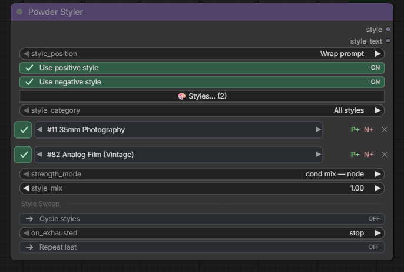

#### Conditioner — сборка и кодирование итогового промпта

Превращает позитивный и негативный текст в инструкции для модели. При необходимости добавляет настройки Styler, триггеры LoRA, поддерживаемые референсы и Canvas Layout. Текстовые выходы показывают собранные описания; кеш позволяет повторно использовать неизменившиеся кодировки.

**Пример:** держите сюжет в Prompt List, визуальное оформление в Styler, сведения о триггерах в Lora Loader и объедините их в Conditioner. Для базовой работы достаточно совместимого CLIP и текста; выходы кондишнинга можно подключить к стандартному KSampler. Кеш экономит повторное кодирование текста, а не генерацию нового изображения сэмплером. Auto намеренно обходит классы Flux/T5 и квантованных энкодеров. Aggressive позволяет использовать кеш для них, когда это уместно; CLIP с хуками или расписанием всегда кодируется заново, чтобы не вернуть устаревшие веса или метаданные.

### Размер и генерация

#### Resolution — выбор размеров без ручного расчёта

Предлагает пресеты, соотношение сторон с целевой площадью изображения или точные размеры в пикселях. Задаёт размер батча и создаёт пустой латент для модели. Автоматический выбор формата использует подключённый MODEL; превью показывает выбранные пропорции.

**Пример:** измените квадратную композицию на портретную, сохранив примерно то же число мегапикселей. Подключите `LATENT` прямо к стандартному KSampler. Другие ноды Powder не нужны. Формат латента должен соответствовать модели; размеры могут округляться до поддерживаемой ею сетки.

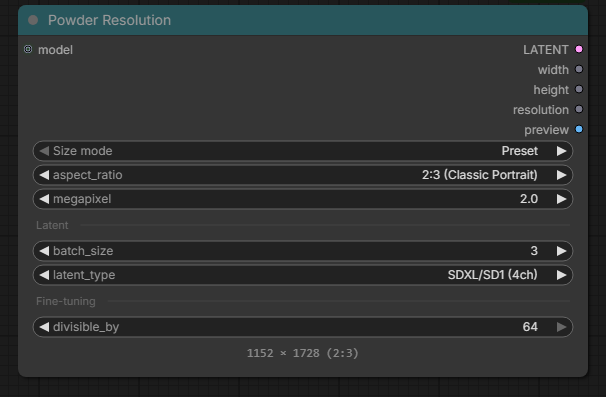

*Портретный пресет, батч из трёх изображений и формат латента с 4 каналами для SDXL.*

#### Sampler — генерация с настройками для разных моделей

Генерирует из пустого латента или перерисовывает подготовленный исходник. Помимо seed, steps, CFG, алгоритма и scheduler, предлагает профили моделей, необязательное масштабирование числа шагов по denoise, обработку маски и настройки сходства внутри батча. Similarity смешивает шум изображений одного батча; одинаковую композицию или идентичность персонажа это не гарантирует.

**Пример:** загрузите SDXL, выберите его профиль и нажмите **Apply profile to sampler**, чтобы заполнить видимые настройки сэмплинга. Подключите стандартные model, conditioning и latent, а выход отправьте в VAE Decode. Другие ноды Powder не обязательны. Применение профиля не загружает и не меняет модель.

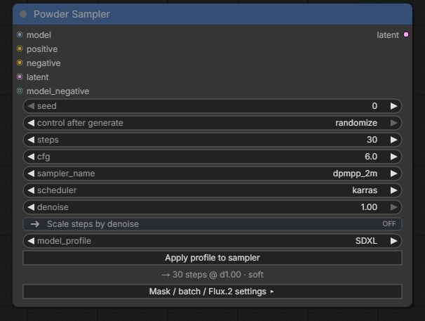

#### Inpaint Sampler — обработка маски в расширенном сэмплинге

Выбирает алгоритм и уровень inpaint boost для графа, в котором уже используются отдельные guider, источник шума и расписание сигм. Нода выдаёт **компонент SAMPLER**, а не выполняет генерацию самостоятельно.

**Пример:** подключите `SAMPLER` к `SamplerCustomAdvanced.sampler`, сохранив стандартные noise, guider, sigmas и latent. Другие ноды Powder не нужны. Для обработки маски латент должен содержать noise mask; к обычному KSampler этот выход не подключается. Сравнивайте boost при одном seed: более сильная настройка не всегда лучше.

### Canvas, референсы и редактирование

#### Canvas — подготовка исходника и области изменения

Загружает изображение или создаёт пустой холст. В развёрнутом редакторе можно работать со слоями, рисовать маску и трансформировать содержимое. Canvas выдаёт обычные image/mask. Отдельная вкладка Layout описывает расположение объектов, персонажей и текста для поддерживаемых моделей.

**Пример:** загрузите фотографию предмета и выделите маской область для перерисовки. Выходы изображения и маски работают со стандартными нодами ComfyUI. Добавьте Image Conditioning и Canvas Review для связанного процесса редактирования и просмотра результатов. Layout использует Conditioner; простое открытие вкладки не включает Layout в генерации.

#### References — согласованные референсы для редактирования

Объединяет исходник и до четырёх дополнительных изображений, чтобы текстовая и графическая подготовка использовали один набор. Нода организует входные данные; способность понимать и применять референсы зависит от выбранной модели.

**Пример:** передайте исходное изображение и отдельный референс одежды, затем опишите изменение. Подключите один пакет к `Conditioner.references` и `Image Conditioning.references`, а сам исходник — к `Image Conditioning.pixels`. Нужны эти ноды Powder и совместимая модель редактирования с референсами. Стандартные энкодеры и KSampler не принимают пакет напрямую.

#### Image Conditioning — подготовка выбранного режима

Подготавливает модель, кондишнинг и латент для **Generate**, **Repaint**, **Repair** или **Edit**. Repaint перерисовывает исходник, Repair работает с фрагментом вокруг маски, Edit использует поддержку редактирования и референсов конкретной моделью. Также нода выдаёт denoise и данные для возвращения обработанного фрагмента на место.

**Пример:** исправьте небольшую область, не обрабатывая весь исходник в полном размере. Передайте подготовленные выходы сэмплеру, декодируйте результат и подключите изображение вместе со `stitch` к Canvas Review. Базовая генерация и полноразмерный img2img работают со стандартными окружающими нодами; для восстановления фрагмента нужен Canvas Review. Пустая маска выбирает всё изображение. **Edit (native)** кодирует исходник без добавления референсных латентов Powder: используйте его, когда текстовый энкодер конкретной модели уже формирует нативный кондишнинг редактирования.

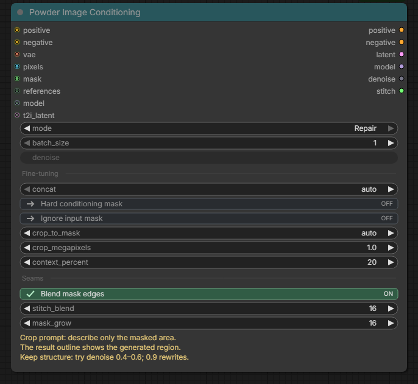

*В режиме Repair доступны настройки контекста вокруг фрагмента, расширения маски и смешивания краёв.*

#### Canvas Review — просмотр результатов и возвращение фрагмента

Принимает декодированные результаты и, если передан stitch, возвращает обработанную область в исходник с сохранёнными маской и настройками смешивания. Подключённый Canvas показывает варианты для просмотра. Принятие результата делает его новым исходником, позволяя редактировать изображение поэтапно.

**Пример:** получите несколько локальных исправлений, сравните их в Canvas и примите лучший вариант. Подключите `Image Conditioning.stitch` и декодированные изображения к Review, а сохраняйте его итоговый image. Обычный просмотр работает самостоятельно; возвращение фрагмента требует Image Conditioning, просмотр в редакторе — Canvas. Сохранение напрямую из VAE Decode обходит восстановление фрагмента.

### Переключение, сравнение и обслуживание

#### Switcher — совместное переключение связанных входов

Объединяет альтернативы в группы с соответствующими каналами. Один выбор переключает активную группу: удобно держать модель, CLIP и VAE вместе. Нода выбирает значения, а не смешивает их.

**Пример:** подключите два checkpoint loader как группы A и B, затем отправьте выбранные выходы в общую цепочку генерации. Другие ноды Powder не нужны. Типы соответствующих каналов должны быть совместимы. Отдельная выходная нода на невыбранной ветке всё ещё может запустить эту ветку независимо.

#### Grid Saver — наглядное сравнение вариантов

Располагает изображения по строкам и столбцам и сохраняет общую сетку. Необязательные сведения о промптах, seed, стилях и LoRA помогают подписывать варианты; параметры также можно сохранить в JSON.

**Пример:** соберите результаты сравнения LoRA на одном листе, чтобы не открывать изображения по очереди. Для простой сетки достаточно декодированных изображений, для более подробных подписей можно добавить метаданные Powder. Другие ноды Powder не обязательны. Нода записывает файлы; в FULL-шаблонах она изначально переведена в bypass, поэтому включите её, когда понадобится сетка.

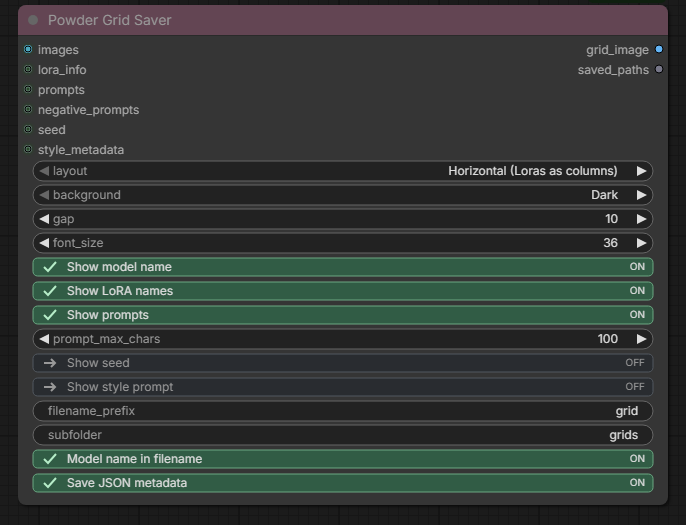

*Расположение сетки, подписи и настройки сохранения собраны в одной ноде.*

#### Cache Stats — просмотр повторно используемых данных

Показывает состояние кешей кондишнинга, исходных данных LoRA и стилей пакета. Отчёт помогает понять, используются ли подготовленные данные повторно, ничего не очищая.

**Пример:** дважды обработайте один текст в Conditioner, затем подключите `Cache Stats.stats` к Preview Any и посмотрите отчёт. Подключённая нода Powder не требуется, но отчёт касается кешей этого пакета, а не всей ComfyUI или общего объёма занятой видеопамяти.

#### Clear Conditioning Cache — повторное кодирование текста

Очищает кеш текстовых кодировок Powder Conditioner, когда их нужно вычислить заново. Измените trigger или нажмите кнопку, затем выполните очистку. Это инструмент для отдельных случаев: очистка перед каждой генерацией убирает пользу кеширования.

**Пример:** выполните очистку отдельно, затем снова запустите граф генерации. Подключения не нужны. Нода не удаляет изображения, не очищает кеши стандартных энкодеров и не выгружает все модели из видеопамяти.

Примеры конкретных подключений и пояснения совместимости доступны внутри ComfyUI в [английском Guide — Node map](example_workflows/powder_node_guide.json).

## Canvas и Layout

**Edit canvas** нужен для слоёв и маски. Repaint перерисовывает исходник, Repair обрабатывает фрагмент вокруг маски, Edit использует возможности редактирования выбранной модели. В промпте описывайте изменяемую область. Пустая маска означает всё изображение. Низкий denoise лучше сохраняет исходник, высокий допускает более сильные изменения.

В **View results** можно сравнить варианты. Примите результат, чтобы он стал новым исходником. В связке Image Conditioning + Canvas Review данные stitch возвращают фрагмент на место и сохраняют область вне редактирования.

**Layout** задаёт расположение объектов, персонажей и текста. Включите **Use layout**, выберите подходящую модель и синхронизируйте описание сцены после изменения регионов. Прямоугольники — инструкции по композиции, а не точные границы пикселей или маски. Reset all очищает содержимое, сохраняя текущую вкладку.

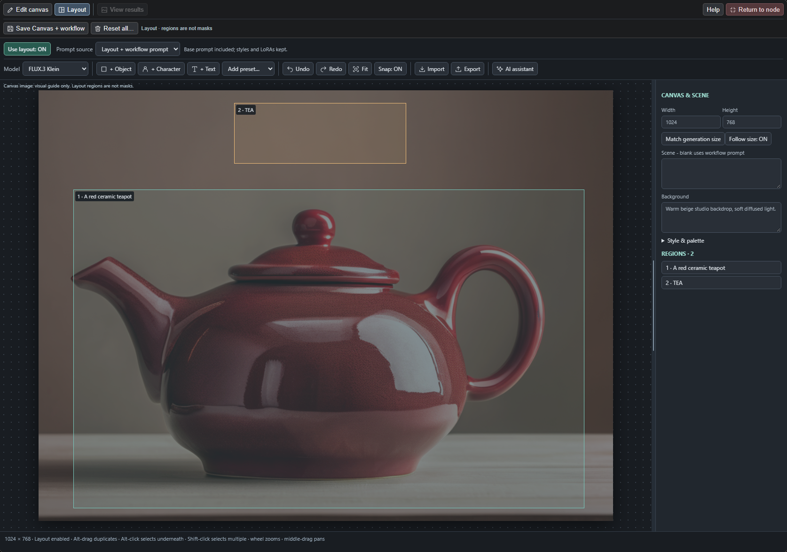

Включите **Save mask in workflow**, если маска должна восстановиться после открытия графа. Дождитесь окончания сохранения перед сохранением воркфлоу. Файлы Canvas и снимки заданий находятся в `ComfyUI/input/e2go_canvas`; сохраняйте их, пока они нужны воркфлоу, очереди или истории. Сам JSON не содержит все внешние изображения и файлы моделей.

## Примеры воркфлоу

В папке [workflows](example_workflows) — 43 шаблона для SDXL, FLUX.2 Klein, FLUX.3 Klein, BOOGU, Z-Image, MOSS SFT, Krea 2, Qwen 2.1 и Ideogram 4. Заметки внутри графов объясняют режим и настройку модели. Имена файлов — примеры: выберите соответствующие файлы на своём компьютере. Для некоторых семейств нужны свежие ноды ядра ComfyUI; используйте указанные выше поддерживаемые версии.

| Задача | Воркфлоу |
| --- | --- |
| SDXL из текста | [Generate](example_workflows/E2GO_SDXL_Generate.json) / [Full](example_workflows/E2GO_SDXL_Generate_full.json) |
| SDXL из изображения | [Img2Img](example_workflows/E2GO_SDXL_Img2Img_full.json) |
| FLUX.3 Klein | [Generate](example_workflows/E2GO_Flux3_Klein_Base_Generate.json) / [Edit](example_workflows/E2GO_Flux3_Klein_Base_Edit.json) |
| BOOGU | [Generate](example_workflows/E2GO_Boogu_Base_Generate.json) / [Edit](example_workflows/E2GO_Boogu_Edit.json) |
| Krea 2 | [Generate](example_workflows/E2GO_Krea2_Generate_simple.json) / [Edit](example_workflows/E2GO_Krea2_Edit_simple.json) |
| Qwen 2.1 | [Generate](example_workflows/E2GO_Qwen21_Generate_simple.json) / [Edit](example_workflows/E2GO_Qwen21_Edit_simple.json) |
| Изучить ноды | [Guide — Node map](example_workflows/powder_node_guide.json) |

**Ideogram 4:** [LITE](example_workflows/E2GO_Ideogram4_Generate.json) содержит готовое редактируемое JSON-описание. [FULL](example_workflows/E2GO_Ideogram4_Generate_full.json) по умолчанию использует **Enhanced**: отдельная локальная Qwen3-VL 4B описывает сцену, стиль, фон и объекты. **Original** пропускает enhancer; для этого пути используйте полное описание вручную. Обычный текст по-прежнему принимается, но обёртка с пустыми полями не даёт такой же структуры. Инструкция enhancer просит описывать расположение словами и сохранять заданные координаты, не придумывая новые; для точных регионов используйте Canvas Layout. Проверяйте полученный caption: enhancer может изменить детали, а корректный JSON сам по себе не гарантирует хорошего изображения.

В Powder Sampler переключатель **Ideogram sampling** предлагает **Standard** (по умолчанию) и **First sigma +0.005 (experimental)**. Альтернатива меняет только первую сигму, сохраняя число шагов и веса моделей. Она может помочь с серыми заглушками, но способна изменить композицию или добавить артефакты. Настройка независима от Original / Enhanced; другие семейства моделей её игнорируют. Сравнивайте с одинаковым фиксированным сидом. После обновления перезапустите ComfyUI; старые воркфлоу без этого поля сохраняют Standard.

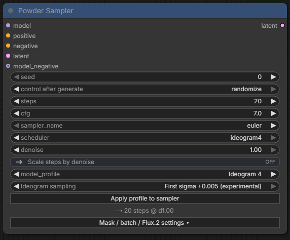

## Локальные данные и решение проблем

Позиция Wildcard и Style Sweep относится к текущей сессии: перезагрузка браузера или перезапуск сервера создаёт новый курсор. Reset устанавливает `start_index` в ноль. Repeat last удерживает выбранный текст/стиль при последующих запусках, но не ставит задание в очередь и не возвращает seed.

При `stitch_blend > 0` полностью закрашенные пиксели получают полную правку, а окружающая полоса растушёвки тоже может измениться в пределах обработанного фрагмента. За этой полосой пиксели сохраняются. Для строгого сохранения вне эффективной маски задайте `stitch_blend=0`; `mask_grow` намеренно расширяет маску. При обработке батча сохраняется каждый исходник, а общий фрагмент охватывает все активные маски.


- Личные стили хранятся в `styles/sdxl_styles_user.json`, файлы wildcard — в `wildcards/`. Git их игнорирует, поэтому обычное обновление сохраняет ваши данные.
- Если после обновления интерфейс выглядит устаревшим, перезапустите ComfyUI и обновите страницу.
- При ошибке несовместимости модели и латента проверьте модель, формат в Resolution и профиль Sampler вместе. Применение профиля меняет настройки сэмплера, а не загруженную модель.
- Если перебор стилей или wildcard остановился, возможно, закончился список. Выберите Loop или сбросьте позицию.
- Для воспроизводимой ошибки создайте [GitHub Issue](https://github.com/E2GO/e2go-comfyui-nodes/issues), приложив версию ComfyUI, воркфлоу и текст ошибки.

## Размеры в FULL-workflow

В FULL-шаблонах редактирования Resolution подключён к входу `t2i_latent` ноды Image Conditioning. В режиме Generate размер задаётся в Resolution; Repaint, Edit и Repair используют исходное изображение или кроп. Размер Layout должен совпадать с результатом: для генерации используйте **Match generation size**, для редактирования задайте размеры исходника или кропа.

## Участники

- **E2GO** — автор и сопровождающий проекта.
- **Claude (Anthropic)** — AI-помощник в первоначальной разработке и сопровождении проекта на ранних этапах.
- **Codex (OpenAI)** — AI-помощник в разработке, тестировании, подготовке релиза и документации.

## Лицензия

[GNU Affero General Public License v3.0](LICENSE).
